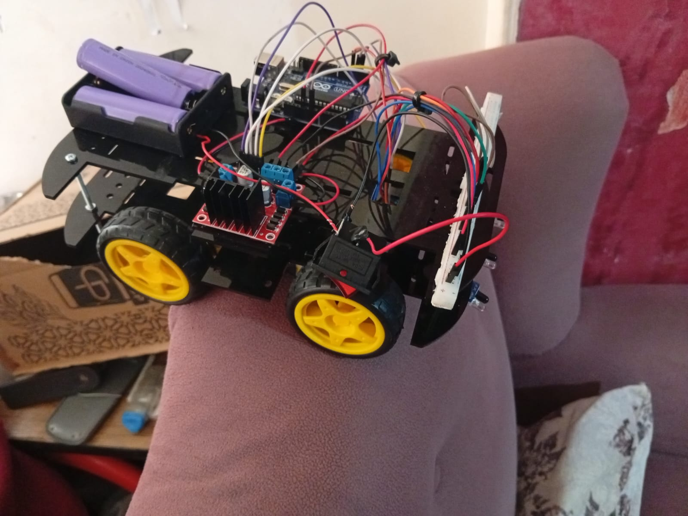
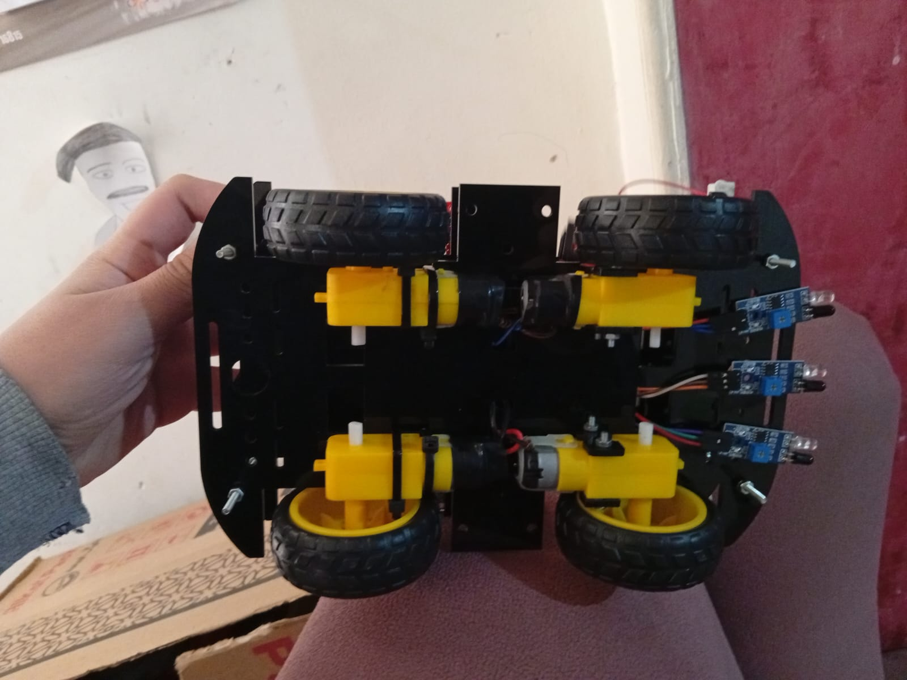
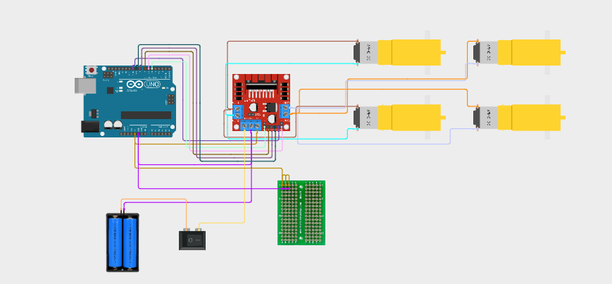
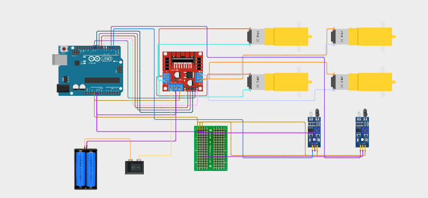

# Autonomous Car: Obstacle Avoiding and Line Following

A 4-wheel autonomous car built with Arduino. I built two versions on the same chassis: one that avoids obstacles and one that follows a black line.

## My Role

I was responsible for the hardware side of this project: wiring the electronics and assembling the car. This was the last project where I worked mainly on hardware.

## Looking Back

After we delivered this project, our teacher shared an idea that stayed with me: when something feels easy for you, it is not necessarily the best choice for you, because you may not be using the strongest version of your abilities.

Hardware was the area where I felt most comfortable. So in my following projects, I deliberately took on harder challenges, mostly on the software side.

## Hardware (shared by both versions)

- Arduino Uno
- L298N motor driver module
- 4 DC gear motors with wheels (acrylic 4WD chassis kit)
- 2x 18650 Li-ion batteries with a battery holder
- Power switch
- Breadboard

*Figure 1: The assembled car.*

*Figure 2: Underside of the chassis, showing the motors and the IR sensors at the front.*

*Figure 3: Base wiring shared by both versions (Arduino, L298N motor driver, four motors, batteries, and switch).*

## Version 1: Obstacle Avoiding

**Extra hardware:** HC-SR04 ultrasonic sensor mounted on a servo motor.

**Logic:**
1. The car drives forward until the ultrasonic sensor detects an object ahead.
2. It stops and uses the servo to scan the left and right sides.
3. If both sides are clear, it turns right and continues.

## Version 2: Line Following

**Extra hardware:** Two IR sensors at the front.

**Logic:**
1. The two IR sensors detect the black line on the ground, and the car follows it.
2. If the line disappears and both sensors stop detecting it, the car drives forward a short distance (two steps) to search for the line again.

*Figure 4: Wiring diagram for the line-following version.*

## Demo Video

A short test run of the car (20 seconds):

[VIDEO LINK HERE]

## What I Learned

- Driving DC motors with an L298N driver and an Arduino
- Reading IR and ultrasonic sensors
- Using a servo motor to scan with a sensor
- Designing simple decision logic for an autonomous robot
- Hardware felt comfortable to me, which pushed me to look for harder challenges in software

## Notes

- The source code is not available at the moment.
- The wiring diagrams were redrawn after the build, so pin numbers may differ from the original wiring.
